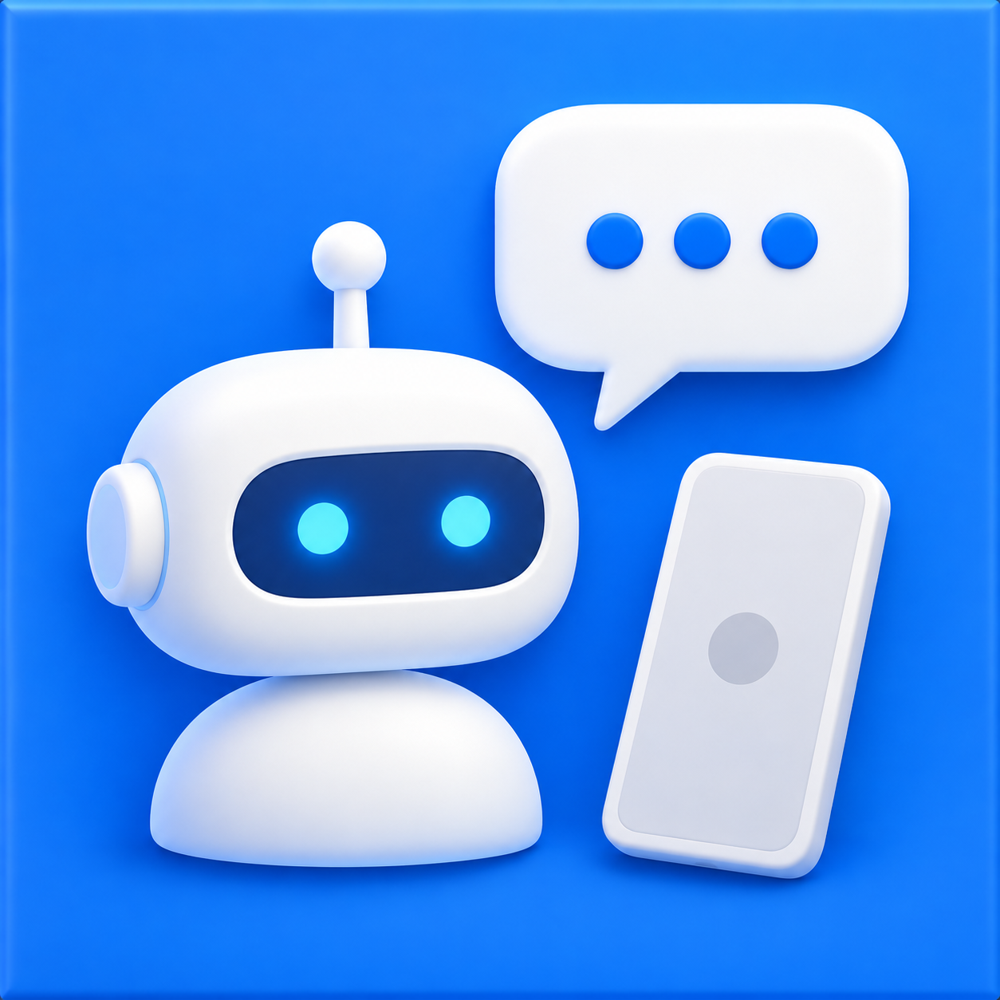
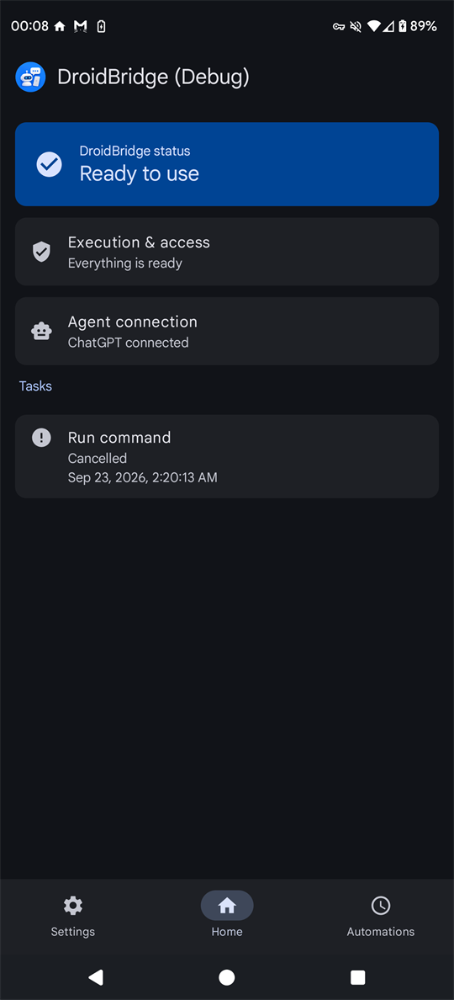
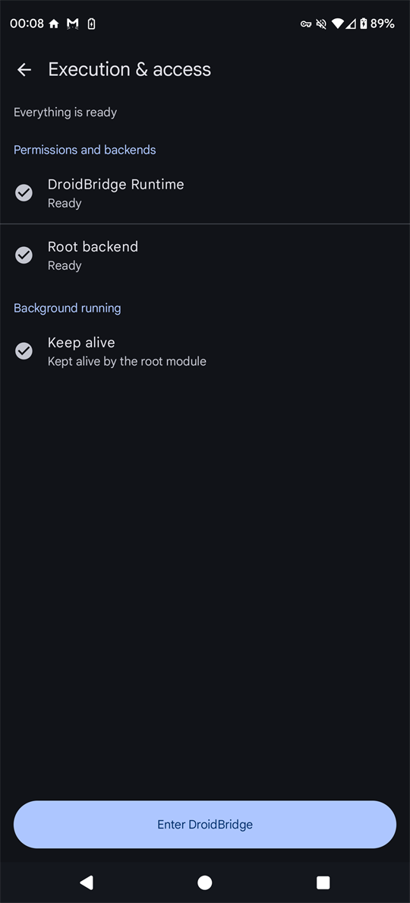
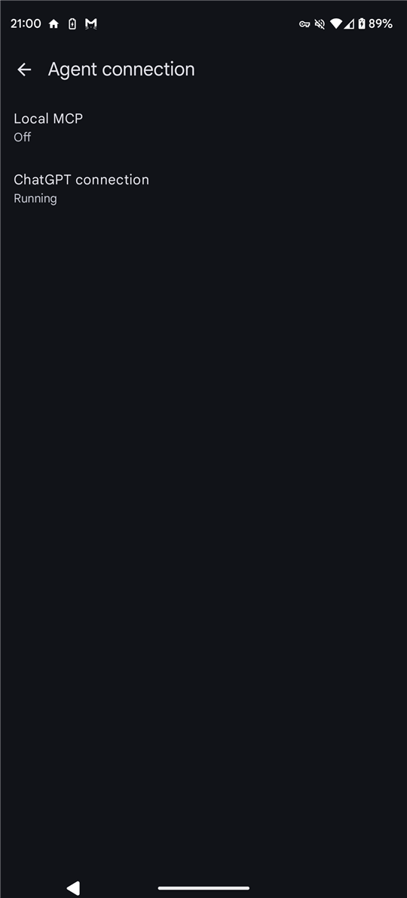
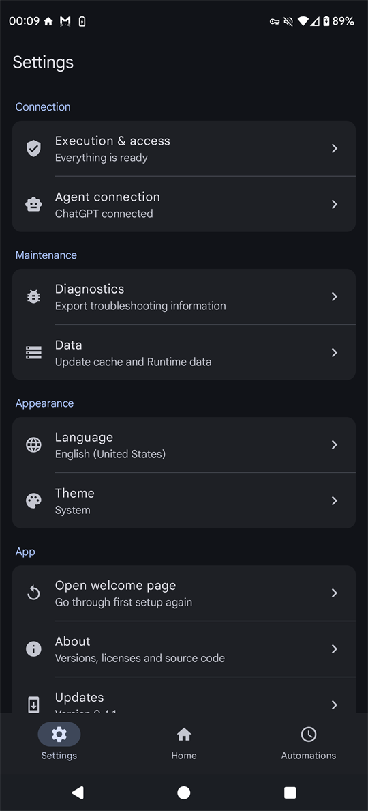

<p align="center">
  
</p>

<h1 align="center">DroidBridge</h1>

<p align="center">
  <b>An on-device MCP server for Android.</b><br>
  Connect ChatGPT through OpenAI's official secure tunnel, let AI agents operate your phone,<br>
  and run scheduled automations on the phone itself — no PC, no ADB.
</p>

<p align="center">
  <a href="LICENSE"></a>
  
  
  
  <a href="https://github.com/zephyr7030/DroidBridge/releases/latest"></a>
  <a href="https://github.com/zephyr7030/DroidBridge/releases"></a>
  <a href="https://t.me/anDroidBridge"></a>
  <a href="https://ko-fi.com/zephyr7030"></a>
</p>

<p align="center">
  <b>English</b> · <a href="README.zh-CN.md">简体中文</a>
</p>

<p align="center">
  
</p>

## Why DroidBridge

- **Official ChatGPT tunnel.** The phone polls OpenAI's Secure MCP Tunnel over HTTPS: no open port,
  no public address and no relay of ours in between.
- **Runs on the phone.** The MCP server and everything it drives live on the device. A computer and
  ADB are only needed if you want an agent on a computer.
- **Automation that outlives the conversation.** Ask once; the phone keeps doing it on a schedule or
  on events. The root edition does it from a backend that starts at boot, with no app involved.
- **Exactly the access you grant.** No extra remote permission layer, no telemetry, open source
  (Apache-2.0).

## How agents connect

Two ways to connect, side by side:

| Connection | For | How it reaches the phone |
|---|---|---|
| **ChatGPT** | ChatGPT on the web (developer mode) | OpenAI's Secure MCP Tunnel. The phone polls OpenAI over HTTPS; no port is opened and no public address is needed. |
| **Local MCP** | Agents on the same device, or on a computer over `adb forward` | Streamable HTTP on `127.0.0.1:8765/mcp` (root edition: port 8766) with a bearer token. |
## What an agent can do

| Tool | What it covers |
|---|---|
| `context` | DroidBridge status, capabilities and the tool catalog |
| `visual` | Observe the screen (image and UI hierarchy), tap, long-press, swipe, type text, press keys and key combinations; hold typed input to the app that was observed, and take exclusive use of screen input with a lease |
| `android` | Inspect packages, launch apps and intents, clipboard, notifications |
| `filesystem` | Inspect, read, write, edit, move, delete, archive (ZIP) and download files |
| `command` | Run shell commands as the app or shell (Shizuku) identity, or as root in the root edition |
| `network` | Diagnose DNS, TCP and TLS; capture and inject traffic (root edition) |
| `automation` | Create, update, enable, delete and run automations (see below) |
| `task_control` | List, inspect and cancel background tasks |

Every tool carries MCP safety annotations (`readOnlyHint`, `destructiveHint`, `openWorldHint`), so
clients such as ChatGPT ask you to confirm actions that change things.

## Automation that keeps running without the AI

Ask an agent once and the phone keeps doing it. Automations are saved on the device and run without
the agent, a computer or an open conversation.

| | What you can build |
|---|---|
| **Triggers** | a point in time · every N minutes (1 minute to 30 days) · calendar rules (RRULE, with a time zone) · events (`runtime.ready`, `network.default_changed`) |
| **Steps** | call a tool action (`visual` interact or element, `android` launch and clipboard, `filesystem` manage and download, `command` run, `network` diagnose) · sequence · if/else on saved state, trigger data or the previous result · repeat · delay · set state · choose per step whether a failure stops the run |
| **Element step** | finds a control by text, description or resource id *when the run happens*, then taps, long-presses or types, so a saved automation never holds a stale reference |
| **Runs** | up to one hour each; state is kept between runs; every run is a Task you can list, inspect and cancel |
| **Root edition** | the backend starts at boot with no app, arms a wake-up alarm timer for due runs, and can run steps as root (shell commands) |

An agent saves one with `automation` → `save`:

```json
{
  "name": "Morning check",
  "enabled": true,
  "trigger": {
    "type": "rrule",
    "rrule": "DTSTART:20261014T080000\nRRULE:FREQ=DAILY",
    "timezone": "Asia/Shanghai"
  },
  "action": {
    "type": "sequence",
    "children": [
      {"type": "call", "tool": "android", "action": "launch",
       "args": {"operation": "package", "package_name": "com.android.settings"}},
      {"type": "delay", "duration_ms": 3000},
      {"type": "call", "tool": "visual", "action": "element",
       "args": {"operation": "tap", "by": "text", "value": "Network & internet"}}
    ]
  }
}
```
## Choose your edition

DroidBridge comes in two editions:

- **DroidBridge** is an app that runs everything itself. It works on an ordinary phone and gains
  the shell identity when [Shizuku](https://shizuku.rikka.app/) is running.
- **The root edition** is a root module. Its backend runs as root on its own, starts at boot and
  keeps running whatever happens to any app. It installs the **DroidBridge Root** app, which shows
  the backend's state and settings but runs nothing itself.

Both editions can run on one phone: DroidBridge serves local MCP on port 8765 and the root edition
on port 8766.

| | DroidBridge | DroidBridge + Shizuku | Root edition (Magisk / KernelSU / APatch) |
|---|---|---|---|
| Screen observe / tap / type | Accessibility service | Observe/tap; typing uses Accessibility | ✓ |
| Screen capture | Screen-capture consent | ✓ | ✓ |
| Notifications | Notification access | Notification access | ✓ |
| Shell commands | App identity | App and shell identity | Root identity |
| Network capture / injection | — | — | ✓ |
| Stays alive in the background | Battery and autostart settings | Kept alive until the next reboot | Runs on its own, restored after reboot |

In DroidBridge, the **Execution & access** page walks you through each switch with a button that
opens the right system page, and tells you when something is already covered by Shizuku.

## Requirements

- Android 13 to 17 on an **arm64-v8a** device. The DroidBridge app also ships **x86_64**
  libraries, so it runs on x86_64 emulators; the root edition is arm64-v8a only.
- For ChatGPT: a plan with web developer mode (Plus or higher), a Secure MCP Tunnel and a Runtime
  API key from the OpenAI platform.
- Optional: [Shizuku](https://shizuku.rikka.app/), [Magisk](https://github.com/topjohnwu/Magisk),
  [KernelSU](https://github.com/tiann/KernelSU) or [APatch](https://github.com/bmax121/APatch) for
  the root edition.

## Install

**DroidBridge**

1. Download `droidbridge-<version>-arm64-v8a.apk` from the
   [latest release](https://github.com/zephyr7030/DroidBridge/releases/latest) (tag `apk-v<version>`)
   and install it. The name is historical: this one APK carries both the arm64-v8a and the x86_64
   libraries.
2. Open DroidBridge. The first-run guide asks which agent you use and walks through permissions.

The release ships a `SHA256SUMS.txt` and a signed `release.json`; the app's **Updates** page uses
the signature to verify its own updates.

**Root edition**

1. Download `droidbridge-magisk-<version>.zip` from the newest
   [`magisk-v` release](https://github.com/zephyr7030/DroidBridge/releases?q=magisk-v&expanded=true).
2. Install it in Magisk, KernelSU or APatch. Installing it also installs the DroidBridge Root app.
3. Reboot, then open DroidBridge Root.

Module updates are offered by your root manager.

## Connect ChatGPT

1. On [platform.openai.com](https://platform.openai.com/settings/organization/tunnels) create a
   Secure MCP Tunnel, and an [API key](https://platform.openai.com/api-keys) allowed to use it.
2. In DroidBridge open **Agent connection → ChatGPT connection**, paste the Tunnel ID and the key,
   and turn the tunnel on. The key is never shown again: DroidBridge encrypts it with the Android
   Keystore, and the root edition keeps it readable by root only.
3. On a computer browser, turn on **Developer mode** in [ChatGPT security settings](https://chatgpt.com/settings/security)
   (it is still rolling out to Plus accounts). Then on [ChatGPT plugins](https://chatgpt.com/plugins)
   tap **Add → Create MCP app**, connect it through your tunnel with Authentication set to **None**.
   The app page has links to both.
4. Ask ChatGPT to use DroidBridge. The first call shows up in the app.

## Connect a local agent

1. In the app open **Agent connection → Local MCP** and turn it on.
2. Tap **Copy setup prompt** and paste it into your agent (Codex, Claude Code, opencode and others).
   The agent forwards the port if it runs on a computer, adds the server to its own MCP
   configuration and checks the connection. The prompt contains the access token.
   The same prompt with placeholders is in [AGENT-SETUP.md](AGENT-SETUP.md).

To set it up by hand instead, copy the token and:

1. Point your MCP client at `http://127.0.0.1:8765/mcp` (root edition: `8766`) with
   `Authorization: Bearer <token>`. The endpoint speaks MCP 2026-07-28 and also serves clients
   that still begin with `initialize` (2025-03-26, 2025-06-18 and 2025-11-25).
   From a computer, forward the port first; any free local port works:

   ```bash
   adb forward tcp:8765 tcp:8765
   ```

   Claude Code:

   ```bash
   claude mcp add --transport http droidbridge http://127.0.0.1:8765/mcp --header "Authorization: Bearer <token>"
   ```

   Codex, with the token in an environment variable:

   ```bash
   codex mcp add droidbridge --url http://127.0.0.1:8765/mcp --bearer-token-env-var DROIDBRIDGE_TOKEN
   ```

## Screenshots

| Home | Execution & access | Agent connection | Settings |
|---|---|---|---|
|  |  |  |  |

## Security and privacy

- Everything runs on the phone. DroidBridge has no server of its own and sends no telemetry.
- An agent gets **exactly** the access you granted on the device; there is no extra remote
  permission layer to misconfigure. Only connect agents you trust with that access.
- The ChatGPT tunnel speaks only to `api.openai.com` over TLS with a pinned WebPKI root store.
- The local MCP endpoint listens on loopback only and requires its bearer token.
- Text that the system `input` command cannot type (for example Chinese or emoji) is pasted
  through the clipboard: the clip is marked sensitive and your previous clipboard is restored.

Please report vulnerabilities privately as described in [SECURITY.md](SECURITY.md).

## Build from source

Building needs the pinned toolchain (JDK 17, Android SDK 37, NDK 29, Rust 1.98) and is currently
scripted for Windows with PowerShell 7:

```bash
./gradlew :standalone:assembleDebug :root-frontend:assembleDebugMagiskModule
```

The exact versions, the libpcap step and the toolchain check are in [CONTRIBUTING.md](CONTRIBUTING.md).
## Community

Questions, device reports and release news: join the [Telegram group](https://t.me/anDroidBridge).
Bugs are best filed as [GitHub issues](https://github.com/zephyr7030/DroidBridge/issues).

## Acknowledgements

Thanks to **Mike** ([@mikex8593-ai](https://github.com/mikex8593-ai)) for patient, detailed device
testing and reports on a Pixel, a Fold and a Chromebook. They led to the fix for expired request records
that made the store unwritable, the fix for tasks left running after a store write failure, the review
that found the MCP concurrency bug, the x86_64 build ChromeOS needs, and the update failure diagnostics.

## Support the project

DroidBridge is built and maintained in spare time. If it is useful to you, you can support it on
[Ko-fi](https://ko-fi.com/zephyr7030). Bug reports and device reports help just as much.

## License

DroidBridge is licensed under the [Apache License 2.0](LICENSE). Third-party components and their
licenses are listed in [THIRD_PARTY_NOTICES.txt](THIRD_PARTY_NOTICES.txt).

DroidBridge is an independent project and is not affiliated with or endorsed by OpenAI, Anthropic,
Google, Magisk or Shizuku. Product names are trademarks of their respective owners.
